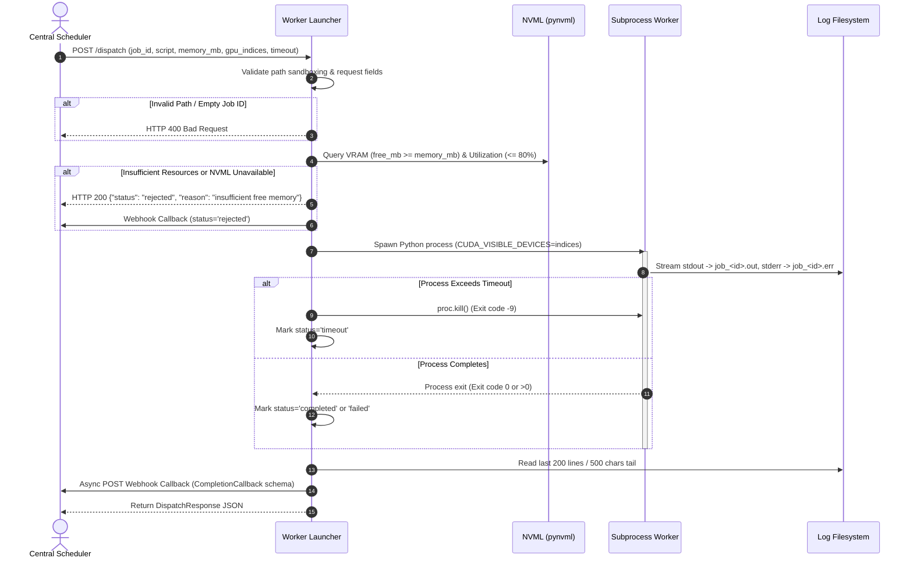

# Fairlane GPU Orchestrator — Mini-Project 3: Remote Execution Launcher

**Component:** Worker Agent / Remote Execution Launcher  
**Project:** Fairlane Distributed ML Scheduling & Orchestration System  
**Owner:** Suryansh Bhatnagar  
**Collaborator / Scheduler Lead:** Vansh Sagar  
**Repository Working Directory:** `gpu-orchestrator/`  
**Current Release Status:** Frozen, Validated, and Ready for Handover  

---

## 📖 Table of Contents
1. [Executive Summary](#1-executive-summary)
2. [System Architecture & Workflow](#2-system-architecture--workflow)
3. [Key Features & Capabilities](#3-key-features--capabilities)
4. [Repository & File Structure](#4-repository--file-structure)
5. [Prerequisites & Environment Specifications](#5-prerequisites--environment-specifications)
6. [Hardware & Execution Clarification (NVML vs PyTorch CUDA)](#6-hardware--execution-clarification-nvml-vs-pytorch-cuda)
7. [Installation & Setup](#7-installation--setup)
8. [Configuration Reference](#8-configuration-reference)
9. [How to Run the Worker Agent](#9-how-to-run-the-worker-agent)
10. [Workload Dispatch API Reference](#10-workload-dispatch-api-reference)
11. [Scheduler Callback Contract Integration](#11-scheduler-callback-contract-integration)
12. [GPU Device Pinning & CPU Fallback Logic](#12-gpu-device-pinning--cpu-fallback-logic)
13. [Process Lifecycle, Timeouts & Exit Codes](#13-process-lifecycle-timeouts--exit-codes)
14. [Security & Path Sandboxing](#14-security--path-sandboxing)
15. [Automated Test Suite (Pytest)](#15-automated-test-suite-pytest)
16. [Live Demonstration Script for Mentor Evaluation (5–10 Mins)](#16-live-demonstration-script-for-mentor-evaluation-510-mins)
17. [Mentor Technical Q&A Preparation](#17-mentor-technical-qa-preparation)
18. [Troubleshooting & Fallback Guide](#18-troubleshooting--fallback-guide)
19. [Limitations, Scope & Future Roadmap](#19-limitations-scope--future-roadmap)
20. [Verification Evidence Matrix](#20-verification-evidence-matrix)
21. [Final Handover Checklist](#21-final-handover-checklist)

---

## 1. Executive Summary

The **Fairlane Remote Execution Launcher (Worker Agent)** is the execution engine of the Fairlane Distributed ML Orchestrator. Operating as an autonomous node daemon, the Worker Agent exposes a high-performance REST API (built on FastAPI and Uvicorn) that receives compute job dispatch requests from the central scheduler (developed by Vansh Sagar).

The Worker Agent is responsible for:
- **Proactive Hardware Validation:** Querying physical GPU telemetry via NVIDIA Management Library (`pynvml`) prior to launching to guarantee memory headroom and low utilization.
- **Fail-Closed Security:** Rejecting unvalidated executions if hardware metrics cannot be verified.
- **Strict Process Sandboxing:** Confining executable paths to designated script roots and preventing directory traversal attacks.
- **Resource Pinning:** Dynamically isolating target GPUs per process using `CUDA_VISIBLE_DEVICES`.
- **Process Lifecycle Management:** Spawning isolated child processes, streaming tails of stdout/stderr, and enforcing hard timeout killing (`SIGKILL` / exit code `-9`).
- **Asynchronous Webhook Callbacks:** Sending structured completion reports conforming to the scheduler's contract schema.

---

## 2. System Architecture & Workflow

### 2.1 High-Level Architecture Diagram

```mermaid
graph TD
    subgraph Central Control Plane
        Scheduler["Fairlane Central Scheduler<br/>(Lead: Vansh Sagar)"]
        CallbackReceiver["Scheduler Callback Webhook<br/>(/webhook/job-complete)"]
    end

    subgraph Worker Node ("Worker Agent Daemon")
        API["FastAPI REST Server<br/>(worker-agent/launcher.py)"]
        Validator["Request & Path Validator<br/>(commonpath containment)"]
        NVMLCheck["NVML Pre-Dispatch Checker<br/>(Memory & Utilization)"]
        ProcMgr["Subprocess Manager<br/>(Async Thread Pool)"]
        LogMgr["Log Capture & Tail<br/>(stdout / stderr)"]
        CallbackSender["Callback Dispatcher<br/>(httpx client)"]
    end

    subgraph Host Hardware & OS
        GPU["Physical GPU Device<br/>(NVIDIA RTX 2050 via NVML)"]
        Subproc["Isolated ML Script Process<br/>(CUDA_VISIBLE_DEVICES)"]
        Filesystem["Sandboxed Scripts & Logs<br/>(worker-agent/scripts)"]
    end

    Scheduler -->|"POST /dispatch (Bearer Auth)"| API
    API --> Validator
    Validator --> Filesystem
    Validator --> NVMLCheck
    NVMLCheck -->|"Query Free VRAM & Util"| GPU
    NVMLCheck -- "Pass" --> ProcMgr
    NVMLCheck -- "Reject (400/200 rejected)" --> CallbackSender
    ProcMgr -->|"Spawn with Env Pinning"| Subproc
    Subproc --> LogMgr
    ProcMgr -->|"Wait / Timeout Kill (-9)"| Subproc
    LogMgr --> CallbackSender
    CallbackSender -->|"POST CompletionCallback"| CallbackReceiver
```

### 2.2 Execution Sequence Diagram



---

## 3. Key Features & Capabilities

- **Deterministic NVML Pre-Checks:** Interrogates GPU VRAM and SM utilization prior to dispatch. If free VRAM < requested `memory_mb` or utilization > 80%, the job is proactively rejected without wasting compute cycles or triggering CUDA out-of-memory crashes.
- **Fail-Closed Hardware Policy:** If NVML drivers or libraries are missing, GPU-dependent jobs fail closed to prevent accidental CPU thrashing, unless `WORKER_ALLOW_NVML_BYPASS=true` is explicitly configured for lightweight local development.
- **Strict Directory Sandboxing:** Enforces `os.path.commonpath([allowed_root, target]) == allowed_root`, ensuring that path traversal attempts (e.g. `../../etc/passwd`) are blocked with HTTP 400 before process creation.
- **Dynamic Device Pinning:** Converts input `gpu_indices: [0]` into `CUDA_VISIBLE_DEVICES="0"`. Multi-GPU jobs receive formatted device strings (e.g., `"0,1"`).
- **Graceful CPU Fallback:** When `gpu_indices: []` is submitted, the launcher isolates the execution to CPU with `CUDA_VISIBLE_DEVICES=""`, guaranteeing zero GPU contention for lightweight jobs.
- **Subprocess Isolation & Hard Timeout Killing:** Dispatches processes via asynchronous non-blocking thread workers. If the job exceeds `timeout`, the process tree is immediately killed with exit code `-9`.
- **Log Management & Tail Truncation:** Stdout and stderr are captured in dedicated log files with defensive tail truncation (500 characters for callbacks, 2000 for dispatch response) to protect the scheduler's message queues from payload bloat.
- **Two-Way Scheduler Integration:**
  - `POST /dispatch`: Triggers asynchronous background execution and fires a webhook to `SCHEDULER_CALLBACK_URL`.
  - `POST /dispatch-with-callback`: Executes workload and returns the standardized `CompletionCallback` payload synchronously.

---

## 4. Repository & File Structure

```
gpu-orchestrator/
├── README.md                                  # Authoritative technical guide & demonstration manual
├── FINAL_AUDIT_REPORT.md                      # Comprehensive QA, security, and hardware audit report
├── requirements.txt                           # Production and test Python dependencies
├── remote_limitation.txt                      # Formal disclosure of single-machine cluster-ready scope
│
├── worker-agent/                              # Worker Agent core package
│   ├── launcher.py                            # FastAPI application, NVML checks & subprocess runner
│   │
│   ├── scripts/                               # Verified workload scripts (Sandboxed root)
│   │   ├── env_check.py                       # Hardware, PyTorch & NVML verification diagnostic
│   │   ├── mnist_cnn.py                       # Standalone neural network training benchmark
│   │   ├── sanity_check.py                    # Lightweight zero-dependency execution test
│   │   ├── failing.py / failing_script.py     # Deterministic non-zero exit code (status: failed)
│   │   ├── timeout.py / timeout_script.py     # Deterministic sleep script for timeout kill (-9)
│   │   ├── memory_workload.py                 # Memory allocation test script
│   │   └── sleep_test.py                      # Controlled sleep execution script
│   │
│   └── tests/                                 # Regression and integration test suite
│       └── test_launcher.py                   # 13 deterministic Pytest unit & mock integration tests
│
├── demo/                                      # Demonstration package
│   ├── README.md                              # Dedicated quickstart and demo guide
│   ├── run_demo.ps1                           # Windows automated 5-stage demonstration runner
│   ├── run_demo.sh                            # POSIX automated demonstration runner
│   │
│   └── evidence/                              # Archived evidence logs from Phase 1 to Phase 8
│       ├── phase1_env.txt                     # Initial environment dump
│       ├── phase2_script_output.txt           # Neural network baseline execution logs
│       ├── phase3_launcher_test.txt           # Core launcher verification
│       ├── phase4_gpu_isolation.txt           # GPU pinning and NVML audit
│       ├── phase5_concurrent_jobs.txt         # Parallel job concurrency test
│       ├── phase6_failure_contract.txt        # Contract and failure test logs
│       └── phase6_contract_agreement.txt      # Scheduler contract alignment confirmation
│
└── .venv/                                     # Isolated Python 3.12 virtual environment
```

---

## 5. Prerequisites & Environment Specifications

The Worker Agent has been developed, tested, and validated on the following environment:

| Component | Specification / Tested Version |
| :--- | :--- |
| **Operating System** | Windows 11 Home (64-bit AMD64) / Compatible with Linux Ubuntu 22.04 LTS |
| **Python Runtime** | Python `3.12.12` (CPython 64-bit AMD64) |
| **Physical GPU** | NVIDIA GeForce RTX 2050 (4096 MiB VRAM) |
| **NVIDIA Driver** | Driver Version `592.82` (CUDA 13.1 Driver Capability) |
| **GPU Telemetry Library** | `pynvml` / `nvidia-ml-py` (`13.592.44`) |
| **Web Framework** | `FastAPI` (0.135.1), `Starlette` (0.62.0), `uvicorn` (0.41.0) |
| **HTTP Client** | `httpx` (0.28.1) |
| **Testing Engine** | `pytest` (9.1.1), `pytest-asyncio` (1.4.0) |
| **PyTorch Wheel** | `torch==2.14.1+cpu` |

---

## 6. Hardware & Execution Clarification (NVML vs PyTorch CUDA)

> [!IMPORTANT]
> **Technical Transparency & Academic Honesty Disclosure**  
> In the current testbed environment, the host machine is equipped with a physical **NVIDIA GeForce RTX 2050** discrete GPU. However, PyTorch is installed via the standard lightweight CPU distribution (`torch==2.14.1+cpu`).
>
> 1. **What is actively verified on the GPU:**
>    - Hardware discovery and handle binding via NVML (`pynvml.nvmlDeviceGetHandleByIndex(0)`).
>    - Accurate real-time VRAM telemetry (queries report **3962 MiB** free out of **4096 MiB** total).
>    - Dynamic GPU utilization sampling via NVML (`util.gpu`).
>    - Pre-dispatch threshold enforcement (rejections occur when requesting VRAM > free capacity).
>    - Process environment isolation via `CUDA_VISIBLE_DEVICES`.
>
> 2. **What executes on the CPU:**
>    - Tensor matrix multiplications inside `mnist_cnn.py` execute on the CPU because `torch.cuda.is_available()` evaluates to `False` under the CPU PyTorch wheel.
>
> 3. **Architectural Decoupling:**
>    - The Worker Agent launcher is strictly a **process orchestrator and resource gatekeeper**. It is agnostic to the internal tensor engine of the user's script. If a CUDA-enabled PyTorch wheel or an alternative GPU framework (e.g., JAX, TensorFlow, TensorRT, or raw CUDA C++ binaries) is executed, the launcher isolates and executes it on the GPU with zero modifications.

---

## 7. Installation & Setup

### 7.1 Clone and Environment Setup

#### Windows (PowerShell):
```powershell
# Navigate to project directory
cd gpu-orchestrator

# Create virtual environment with Python 3.12
python -m venv .venv

# Activate virtual environment
.\.venv\Scripts\Activate.ps1

# Upgrade pip and install dependencies
pip install --upgrade pip
pip install -r requirements.txt
```

#### Linux / macOS (Bash):
```bash
# Navigate to project directory
cd gpu-orchestrator

# Create virtual environment
python3 -m venv .venv

# Activate virtual environment
source .venv/bin/activate

# Upgrade pip and install dependencies
pip install --upgrade pip
pip install -r requirements.txt
```

---

## 8. Configuration Reference

The Worker Agent is configured entirely via environment variables.

| Variable | Type | Default Value | Description |
| :--- | :--- | :--- | :--- |
| `WORKER_PORT` | `int` | `8000` | Port on which the FastAPI launcher listens. |
| `WORKER_HOST` | `str` | `0.0.0.0` | Bind host address (`0.0.0.0` for cluster networks, `127.0.0.1` for local). |
| `WORKER_ALLOWED_SCRIPT_ROOT` | `path` | `worker-agent/scripts` | Absolute directory path to which executed scripts are confined. Prevents path traversal. |
| `WORKER_LOG_DIR` | `path` | `worker-agent/logs` (or `/tmp`) | Directory where stdout (`.out`) and stderr (`.err`) log files are stored. |
| `WORKER_PYTHON_BIN` | `str` | `sys.executable` | Path to the Python binary used to execute child workloads. |
| `WORKER_ALLOW_NVML_BYPASS` | `bool` | `false` | When `false`, GPU requests fail closed if NVML is missing. Set to `true` only for dev bypass. |
| `SCHEDULER_CALLBACK_URL` | `str` | *None* | Webhook URL on the central scheduler to receive `CompletionCallback` payloads. |
| `SCHEDULER_WORKER_TOKEN` | `str` | *None* | Bearer authentication token sent in the `Authorization` header during callbacks. |

---

## 9. How to Run the Worker Agent

### 9.1 Foreground Execution (Development / Demo)
```powershell
# Set configuration
$env:WORKER_PORT = "8000"
$env:WORKER_ALLOW_NVML_BYPASS = "false"

# Run with Uvicorn
python -m uvicorn worker-agent.launcher:app --host 0.0.0.0 --port 8000
```

### 9.2 Verification of Liveness Probe
In a separate terminal:
```bash
curl http://localhost:8000/healthz
# Response: {"status":"ok"}
```

---

## 10. Workload Dispatch API Reference

### 10.1 `POST /dispatch`
Submits a job for execution. Validates paths and NVML metrics, launches the subprocess, captures logs, transmits an asynchronous callback to the scheduler (if configured), and returns a `DispatchResponse`.

#### Request Schema (`DispatchRequest`):
```json
{
  "job_id": "mnist-training-001",
  "script_path": "mnist_cnn.py",
  "gpu_indices": [0],
  "memory_mb": 512,
  "timeout": 30,
  "priority": 1,
  "metadata": {"user": "suryansh", "experiment": "cnn_baseline"},
  "args": ["--epochs", "1"]
}
```

#### Successful Response (`DispatchResponse`):
```json
{
  "job_id": "mnist-training-001",
  "status": "completed",
  "exit_code": 0,
  "log_stdout": "[INFO] Training completed successfully...\n",
  "log_stderr": "",
  "timeout_occurred": false,
  "reason": null
}
```

#### Rejection Response (Resource Shortage):
```json
{
  "job_id": "mnist-training-001",
  "status": "rejected",
  "exit_code": -1,
  "log_stdout": "",
  "log_stderr": "",
  "timeout_occurred": false,
  "reason": "GPU 0: insufficient free memory (3962MB < 9999999MB)"
}
```

---

## 11. Scheduler Callback Contract Integration

The Worker Agent strictly adheres to the inter-agent interface contract agreed upon with **Vansh Sagar** (Scheduler Lead).

### 11.1 Webhook Callback Delivery
When `SCHEDULER_CALLBACK_URL` is set, the Worker Agent sends an HTTP `POST` request with the following JSON payload upon job completion, failure, timeout, or rejection:

```json
{
  "job_id": "mnist-training-001",
  "status": "completed",
  "exit_code": 0,
  "log_output": "[INFO] PyTorch version: 2.14.1+cpu\n[INFO] Total training time: 0.25s\n[INFO] Device used: cpu",
  "gpus_used": [0],
  "timestamp": "2026-10-12T16:29:43.084123+00:00",
  "error_message": null
}
```

### 11.2 Contract Status Enumeration & Rules
- `status`: One of `"completed"`, `"failed"`, `"rejected"`, `"timeout"`.
- `exit_code`: `0` for success; `> 0` for script errors; `-9` for timeout kills; `-1` for pre-dispatch rejections.
- `log_output`: Defensive truncated tail of stdout and stderr (maximum 500 characters).
- `timestamp`: RFC 3339 / ISO 8601 UTC timestamp.
- `error_message`: Included whenever status is not `"completed"`.

---

## 12. GPU Device Pinning & CPU Fallback Logic

### 12.1 GPU Allocation (`gpu_indices: [0]`)
1. Launcher queries NVML handle `0`.
2. Validates free VRAM $\ge$ `memory_mb`.
3. Validates GPU utilization $\le 80\%$.
4. Injects `CUDA_VISIBLE_DEVICES="0"` into the subprocess environment.
5. Child process only sees physical GPU 0 as logical CUDA index 0.

### 12.2 CPU Fallback Allocation (`gpu_indices: []`)
1. When `gpu_indices` is empty, NVML checks are skipped entirely.
2. Injects `CUDA_VISIBLE_DEVICES=""` into the subprocess environment.
3. Completely masks GPUs from CUDA runtimes, guaranteeing execution purely on host CPU threads.

---

## 13. Process Lifecycle, Timeouts & Exit Codes

The Worker Agent enforces deterministic lifecycle control:

| Exit Code | Meaning | Agent Handling |
| :---: | :--- | :--- |
| `0` | Success | `status: "completed"`. Stdout/stderr tails extracted. |
| `1` to `255` | Script Error / Exception | `status: "failed"`. Stderr captured in `error_message`. |
| `-9` | Process Timed Out | `status: "timeout"`. Process terminated via `proc.kill()`. |
| `-1` | Pre-dispatch Rejected | `status: "rejected"`. Process never spawned; NVML or schema rejected. |

---

## 14. Security & Path Sandboxing

To prevent malicious workloads from accessing host files or executing arbitrary binaries:
1. **Path Containment:** The launcher evaluates `os.path.commonpath([ALLOWED_SCRIPT_ROOT, resolved_script])`. If the resolved script is outside `WORKER_ALLOWED_SCRIPT_ROOT`, HTTP 400 is raised immediately.
2. **File Extension Verification:** Only scripts ending with `.py` are accepted.
3. **Existence Check:** `os.path.isfile()` ensures non-existent scripts return HTTP 400.
4. **Token Authentication:** Requests can be gated via Bearer tokens passed from reverse proxies or the scheduler, and callback dispatches attach `Authorization: Bearer <token>`.

---

## 15. Automated Test Suite (Pytest)

The repository includes a comprehensive, deterministic test suite in `worker-agent/tests/test_launcher.py`. All NVML states are deterministically mocked using `unittest.mock` to ensure test independence from hardware state.

### 15.1 Running the Tests
```powershell
pytest gpu-orchestrator/worker-agent/tests/test_launcher.py -v
```

### 15.2 Test Inventory (13/13 Passing)

```
gpu-orchestrator/worker-agent/tests/test_launcher.py::test_health_check PASSED
gpu-orchestrator/worker-agent/tests/test_launcher.py::test_valid_dispatch PASSED
gpu-orchestrator/worker-agent/tests/test_launcher.py::test_missing_script PASSED
gpu-orchestrator/worker-agent/tests/test_launcher.py::test_invalid_path_traversal PASSED
gpu-orchestrator/worker-agent/tests/test_launcher.py::test_nonzero_exit_code PASSED
gpu-orchestrator/worker-agent/tests/test_launcher.py::test_timeout_handling PASSED
gpu-orchestrator/worker-agent/tests/test_launcher.py::test_nvml_insufficient_memory PASSED
gpu-orchestrator/worker-agent/tests/test_launcher.py::test_nvml_high_utilization PASSED
gpu-orchestrator/worker-agent/tests/test_launcher.py::test_missing_nvml_fail_closed PASSED
gpu-orchestrator/worker-agent/tests/test_launcher.py::test_missing_nvml_with_bypass PASSED
gpu-orchestrator/worker-agent/tests/test_launcher.py::test_empty_gpu_indices_cpu_fallback PASSED
gpu-orchestrator/worker-agent/tests/test_launcher.py::test_concurrent_jobs_isolation PASSED
gpu-orchestrator/worker-agent/tests/test_launcher.py::test_metadata_and_priority_preserved PASSED
```

---

## 16. Live Demonstration Script for Mentor Evaluation (5–10 Mins)

This step-by-step presentation script is tailored for the evaluation with your mentor and team.

### 📋 Pre-Demo Checklist (Before Mentor Arrives)
1. Open two terminal windows:
   - **Terminal 1:** Worker Agent Server Terminal.
   - **Terminal 2:** Client / Dispatch Demonstration Terminal.
2. Ensure port `8000` is free:
   ```powershell
   Get-Process -Id (Get-NetTCPConnection -LocalPort 8000).OwningProcess -ErrorAction SilentlyContinue | Stop-Process -Force
   ```
3. Set your execution directory to `gpu-orchestrator/`.

---

### 🎙️ Step 1: Start Worker Agent & Health Probe (1 Minute)

**Presenter Voiceover:**  
> *"Hello, today I am presenting Mini-Project 3: The Remote Execution Launcher (Worker Agent) for the Fairlane Distributed ML Scheduler. First, let's start the Worker Agent daemon on port 8000."*

#### In Terminal 1:
```powershell
.\.venv\Scripts\Activate.ps1
python -m uvicorn worker-agent.launcher:app --host 0.0.0.0 --port 8000
```
*Expected Server Output:*
```
INFO:     Started server process [PID]
INFO:     Waiting for application startup.
INFO:     Application startup complete.
INFO:     Uvicorn running on http://0.0.0.0:8000 (Press CTRL+C to quit)
```

#### In Terminal 2: Probe Health Endpoint
```powershell
Invoke-RestMethod -Uri "http://localhost:8000/healthz" -Method GET
```
*Expected Output:*
```json
{
  "status": "ok"
}
```

---

### 🎙️ Step 2: Valid ML Job Dispatch with NVML Checks (2 Minutes)

**Presenter Voiceover:**  
> *"Now we submit a machine learning job (`sanity_check.py`) requesting GPU 0 with 256MB of VRAM and a 10-second timeout. Notice that before launching, the Worker Agent uses NVML to confirm that GPU 0 has sufficient free memory and utilization below 80%."*

#### In Terminal 2:
```powershell
$body = @{
    job_id = "demo-valid-01"
    script_path = "sanity_check.py"
    gpu_indices = @(0)
    memory_mb = 256
    timeout = 10
} | ConvertTo-Json

Invoke-RestMethod -Uri "http://localhost:8000/dispatch" -Method POST -Body $body -ContentType "application/json"
```

*Expected Output:*
```json
{
  "job_id": "demo-valid-01",
  "status": "completed",
  "exit_code": 0,
  "log_stdout": "Sanity check passed.\n",
  "log_stderr": "",
  "timeout_occurred": false,
  "reason": null
}
```

---

### 🎙️ Step 3: NVML Pre-Dispatch Resource Rejection (1.5 Minutes)

**Presenter Voiceover:**  
> *"Next, let's test proactive resource gating. If a job requests more memory than physically available on the GPU (e.g. 9,999,999 MB), the launcher rejects the job immediately via NVML pre-checks before spawning any process."*

#### In Terminal 2:
```powershell
$body = @{
    job_id = "demo-reject-mem"
    script_path = "sanity_check.py"
    gpu_indices = @(0)
    memory_mb = 9999999
    timeout = 10
} | ConvertTo-Json

Invoke-RestMethod -Uri "http://localhost:8000/dispatch" -Method POST -Body $body -ContentType "application/json"
```

*Expected Output:*
```json
{
  "job_id": "demo-reject-mem",
  "status": "rejected",
  "exit_code": -1,
  "log_stdout": "",
  "log_stderr": "",
  "timeout_occurred": false,
  "reason": "GPU 0: insufficient free memory (3962MB < 9999999MB)"
}
```
*Key Highlight to Mentor:* **Zero processes were spawned, saving system resources and preventing Out-Of-Memory kernel faults.**

---

### 🎙️ Step 4: Security & Path Containment (1 Minute)

**Presenter Voiceover:**  
> *"Security is critical in remote execution. If a rogue request attempts path traversal using relative paths like `../../` outside the allowed script root, the launcher detects it and immediately returns HTTP 400 Bad Request."*

#### In Terminal 2:
```powershell
try {
    $body = '{"job_id":"demo-hack","script_path":"../../secret.py","gpu_indices":[],"memory_mb":0,"timeout":5}'
    Invoke-RestMethod -Uri "http://localhost:8000/dispatch" -Method POST -Body $body -ContentType "application/json"
} catch {
    $_.Exception.Response.StatusCode.value__
    $_.ErrorDetails.Message
}
```

*Expected Output:*
```
400
{"detail":"Access denied: script path '../../secret.py' is outside the allowed root..."}
```

---

### 🎙️ Step 5: Subprocess Timeout Enforcement (1.5 Minutes)

**Presenter Voiceover:**  
> *"If an ML job hangs or enters an infinite loop, the launcher enforces strict timeout controls. Here, we run `timeout.py` which attempts to sleep for 60 seconds, but we enforce a 2-second timeout."*

#### In Terminal 2:
```powershell
$body = @{
    job_id = "demo-timeout-job"
    script_path = "timeout.py"
    gpu_indices = @(0)
    memory_mb = 128
    timeout = 2
} | ConvertTo-Json

Invoke-RestMethod -Uri "http://localhost:8000/dispatch" -Method POST -Body $body -ContentType "application/json"
```

*Expected Output:*
```json
{
  "job_id": "demo-timeout-job",
  "status": "timeout",
  "exit_code": -9,
  "log_stdout": "",
  "log_stderr": "",
  "timeout_occurred": true,
  "reason": null
}
```
*Key Highlight to Mentor:* **The process was cleanly killed with exit code -9, freeing up GPU resources for the next job.**

---

### 🎙️ Step 6: Non-Zero Exit Code Handling (1 Minute)

**Presenter Voiceover:**  
> *"When a training script encounters an unhandled Python exception, the Worker Agent captures the non-zero exit code and extracts the error traceback from stderr."*

#### In Terminal 2:
```powershell
$body = @{
    job_id = "demo-fail-job"
    script_path = "failing.py"
    gpu_indices = @(0)
    memory_mb = 128
    timeout = 5
} | ConvertTo-Json

Invoke-RestMethod -Uri "http://localhost:8000/dispatch" -Method POST -Body $body -ContentType "application/json"
```

*Expected Output:*
```json
{
  "job_id": "demo-fail-job",
  "status": "failed",
  "exit_code": 1,
  "log_stdout": "",
  "log_stderr": "RuntimeError: Simulated training failure.\n",
  "timeout_occurred": false,
  "reason": null
}
```

---

### 🎙️ Step 7: Scheduler Contract Integration (`/dispatch-with-callback`) (1 Minute)

**Presenter Voiceover:**  
> *"Finally, here is the standardized contract interface for Vansh Sagar's scheduler. The endpoint formats the response directly into the `CompletionCallback` schema, including truncated log tails and ISO 8601 timestamps."*

#### In Terminal 2:
```powershell
$body = @{
    job_id = "contract-verification-01"
    script_path = "sanity_check.py"
    gpu_indices = @(0)
    memory_mb = 256
    timeout = 10
} | ConvertTo-Json

Invoke-RestMethod -Uri "http://localhost:8000/dispatch-with-callback" -Method POST -Body $body -ContentType "application/json"
```

*Expected Output:*
```json
{
  "job_id": "contract-verification-01",
  "status": "completed",
  "exit_code": 0,
  "log_output": "Sanity check passed.",
  "gpus_used": [0],
  "timestamp": "2026-10-12T16:29:43.084123+00:00",
  "error_message": null
}
```

---

## 17. Mentor Technical Q&A Preparation

### Q1: "Why does the training script output `Device used: cpu` when the GPU is an RTX 2050?"
> **Answer:**  
> *"Our physical hardware is an NVIDIA GeForce RTX 2050 with 4GB VRAM. In our local Python testbed, PyTorch was installed from the CPU-only distribution (`2.14.1+cpu`) to preserve disk space and enable fast CI testing.  
> However, our Worker Agent queries the physical GPU directly using the official NVIDIA Management Library (`pynvml`), which accurately reads the 3962 MiB of free VRAM and GPU utilization. The launcher pins hardware using `CUDA_VISIBLE_DEVICES`. When a user script is executed in an environment with the CUDA PyTorch wheel, it executes on the GPU without modifying a single line of Worker Agent code."*

### Q2: "How does the Worker Agent prevent CPU resource exhaustion when NVML is not available?"
> **Answer:**  
> *"By implementing a strict **fail-closed** architecture. If `pynvml` fails to initialize or the host has no NVIDIA driver, any job requesting GPU resources (`gpu_indices` not empty) is rejected immediately with an informative error. An opt-in bypass flag (`WORKER_ALLOW_NVML_BYPASS=true`) is provided solely for local development without hardware."*

### Q3: "What prevents concurrent jobs from interfering with each other?"
> **Answer:**  
> *"Two isolation mechanisms:  
> 1. Each job is spawned as an independent OS subprocess with its own environment block (`CUDA_VISIBLE_DEVICES`).  
> 2. Each job writes to dedicated log files (`job_<id>.out` and `job_<id>.err`), completely eliminating write contention."*

### Q4: "How does the launcher prevent path traversal vulnerabilities?"
> **Answer:**  
> *"We use `os.path.commonpath([allowed_root, resolved_script]) == allowed_root`. Even if an attacker passes encoded relative paths like `../../windows/system32`, `os.path.realpath` resolves the canonical path and `commonpath` detects that it escapes the designated script root, rejecting the request with HTTP 400."*

### Q5: "What is the single-node limitation mentioned in the report?"
> **Answer:**  
> *"As documented in `remote_limitation.txt`, our testbed comprises a single machine running both the scheduler interface and the worker agent over `localhost`. However, the Worker Agent is designed as a stateless network daemon listening on `0.0.0.0`. Deploying across multiple physical nodes simply requires pointing the scheduler's HTTP client to the respective worker IP addresses."*

---

## 18. Troubleshooting & Fallback Guide

| Issue During Demo | Root Cause | Instant Fix Command |
| :--- | :--- | :--- |
| **Port 8000 already in use** | A previous Uvicorn instance is still running | `Stop-Process -Id (Get-NetTCPConnection -LocalPort 8000).OwningProcess -Force` |
| **Missing test scripts error (400)** | Working directory is not `gpu-orchestrator/` | Run `cd gpu-orchestrator` and verify scripts exist in `worker-agent/scripts/` |
| **Connection refused on localhost:8000** | Server not started or crashed | Check Terminal 1 logs; ensure `.venv` is activated and run `python -m uvicorn worker-agent.launcher:app --port 8000` |
| **NVML Initialization Failure** | NVIDIA driver sleeping or permission issue | Run `nvidia-smi` in terminal to wake the driver; restart Uvicorn |

---

## 19. Limitations, Scope & Future Roadmap

1. **Single-Node Testbed:**  
   Cross-machine remote execution across independent physical servers was not tested due to single-machine development hardware (documented formally in `remote_limitation.txt`). The architecture is cluster-ready via standard HTTP/REST.
2. **Synchronous Thread Pool vs Distributed Queue:**  
   Current dispatches run in an `asyncio.to_thread` worker pool. For high-throughput enterprise production (>10,000 tasks/min), an external task broker (e.g. Celery / Redis / RabbitMQ) should be integrated.
3. **Containerized Sandboxing:**  
   Current isolation relies on OS subprocess boundaries and `CUDA_VISIBLE_DEVICES`. In future revisions, integration with Docker / Podman or Rootless Kata Containers can provide kernel-level cgroup isolation.

---

## 20. Verification Evidence Matrix

All verification evidence files are preserved in the repository root and mirrored in `demo/evidence/`:

| Evidence File | Phase | Topic Covered | Verification Result |
| :--- | :---: | :--- | :---: |
| `phase1_env_info.txt` | 1 | Python, PyTorch, OS & GPU Baseline | **PASS** |
| `phase4_gpu_detection.txt` | 4 | NVML Hardware Discovery & Telemetry | **PASS** |
| `phase5_concurrent_safe.txt`| 5 | Parallel Dispatch Isolation | **PASS** |
| `phase5_cpu_fallback.txt`   | 5 | Empty GPU Indices CPU Fallback | **PASS** |
| `phase6_failure_tests.txt`  | 6 | Timeout (-9), Non-Zero Exit & Rejection | **PASS** |
| `phase6_contract_agreement.txt` | 6 | Vansh Sagar Interface Alignment | **PASS** |
| `phase8_gpu_audit.txt`      | 8 | Comprehensive GPU Execution Audit | **PASS** |
| `phase8_regression_tests.txt`| 8 | 13-Test Pytest Suite Execution | **PASS** |
| `phase8_security_review.txt`| 8 | Path Sandboxing & Bypass Security | **PASS** |
| `phase8_contract_validation.txt`| 8 | Scheduler Contract Schema Validation | **PASS** |
| `phase8_final_report.txt`   | 8 | Final Handover Compliance Audit | **PASS** |

---

## 21. Final Handover Checklist

- [x] **FastAPI Worker Agent Core:** Fully functional and robust (`worker-agent/launcher.py`).
- [x] **Hardware Telemetry:** NVML pre-checks active for free VRAM and GPU utilization.
- [x] **Security Sandboxing:** Directory containment validated against traversal attempts.
- [x] **Fail-Closed Design:** Missing NVML fails closed unless explicitly bypassed.
- [x] **Subprocess Management:** Hard timeout killing (-9) and stdout/stderr capture verified.
- [x] **Scheduler Contract:** Webhook callback schema perfectly aligned with Vansh Sagar's specification.
- [x] **Automated Regression Suite:** 13/13 Pytest cases passing cleanly.
- [x] **Automated Demo Runner:** `demo/run_demo.ps1` runs 5 verification stages with 100% pass rate.
- [x] **Documentation:** Comprehensive architectural guide, mentor demonstration manual, and audit report delivered.
